**🌎 Español · [English below ↓](#-english)**

## 👾 Hola, soy Sergio

Profesional en **Negocios Internacionales** (Universidad Santo Tomás, grado en trámite) en Bogotá, Colombia. Resuelvo problemas operativos con la herramienta que el problema pida: **automatización, IA generativa, código y datos**. No vengo de ingeniería: aprendo construyendo.

- 🤖 Automatizo procesos sobre Google Workspace con Apps Script y AppSheet.
- 🧠 Diseño agentes de IA con Claude Code y los conecto con otras herramientas por MCP.
- 🎬 Hago contenido de venta con IA, Blender y DaVinci Resolve para un negocio de impresión 3D.
- 🌎 Busco un rol **remoto o híbrido (Bogotá)** en automatización de procesos, operaciones con IA o mercadeo digital.

## 🕹️ Proyectos

| Proyecto | Qué es | Enlaces |
|---|---|---|
| **📡 Supplier Radar** | Reconstrucción pública, con datos ficticios, del sistema de proveedores y contratos que construí en mi práctica de compras: solicitudes automáticas, detección de respuestas por niveles de certeza (los casos dudosos pasan a revisión humana) y tableros calculados solo con fechas. Apps Script, sin herramientas de pago. | [Demo](https://dsergio909.github.io/supplier-radar/) · [Código](https://github.com/Dsergio909/supplier-radar) |
| **🔭 Supplier Scout** | Busca y compara proveedores, incluso los que no están en internet: costo real del pedido, reseñas ponderadas, confianza por referidos y un agente opcional con la API de Claude. 23 países y 4 idiomas. | [Demo](https://dsergio909.github.io/supplier-scout/) · [Código](https://github.com/Dsergio909/supplier-scout) |
| **🦊 Agentes de IA para FoxyMaker3D** | Agentes de diseño 3D y de marketing con Claude Code, conectados a Blender, Bambu Studio y DaVinci Resolve, y un panel local de inventario y contenido (Python, FastAPI, SQLite). | Privado |
| **🎮 Crunch Heist** | Juego de Roblox con universo propio, hecho con Claude Code. | En desarrollo |

## 🧰 Stack

**IA y agentes**

**Automatización**

**Diseño y 3D**

**Negocios y datos**

🧪 **También exploro:** Antigravity · Google Flow · Higgsfield · Adobe

## 📫 Contacto

 

---

## 🌎 English

### 👾 Hi, I'm Sergio

**International Business** graduate (Universidad Santo Tomás, diploma pending) based in Bogotá, Colombia. I solve operational problems with whatever tool the problem calls for: **automation, generative AI, code and data**. I don't come from an engineering background: I learn by building.

- 🤖 I automate processes on Google Workspace with Apps Script and AppSheet.
- 🧠 I design AI agents with Claude Code and connect them to other tools through MCP.
- 🎬 I create sales content with AI, Blender and DaVinci Resolve for a 3D printing business.
- 🌎 Looking for a **remote or hybrid (Bogotá)** role in process automation, AI operations or digital marketing.

### 🕹️ Projects

| Project | What it is | Links |
|---|---|---|
| **📡 Supplier Radar** | Public rebuild, with synthetic data, of the supplier and contract system I built during my procurement internship: automatic document requests, confidence-tiered reply detection (unclear cases go to human review) and dashboards computed from dates only. Apps Script, zero paid tools. | [Demo](https://dsergio909.github.io/supplier-radar/) · [Code](https://github.com/Dsergio909/supplier-radar) |
| **🔭 Supplier Scout** | Finds and compares suppliers, including those that aren't online: real order cost, weighted reviews, trust from referrals and an optional Claude API agent. 23 countries, 4 languages. | [Demo](https://dsergio909.github.io/supplier-scout/) · [Code](https://github.com/Dsergio909/supplier-scout) |
| **🦊 AI agents for FoxyMaker3D** | 3D design and marketing agents built with Claude Code, connected to Blender, Bambu Studio and DaVinci Resolve, plus a local inventory and content dashboard (Python, FastAPI, SQLite). | Private |
| **🎮 Crunch Heist** | Roblox game with an original world, built with Claude Code. | In development |

### 🧰 Stack
Claude Code · Gemini · Local LLMs (Ollama) · Apps Script · AppSheet · Make · Blender · Inkscape · Canva · Bambu Studio · Bloomberg Market Concepts · Excel

### 📫 Contact
[LinkedIn](https://linkedin.com/in/sergio-david-garcia-celis-836b8a250) · [dsergio909@gmail.com](mailto:dsergio909@gmail.com)
