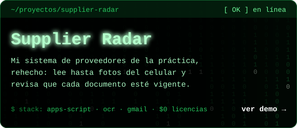
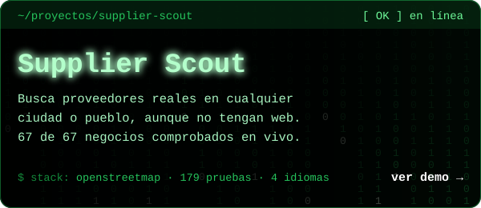
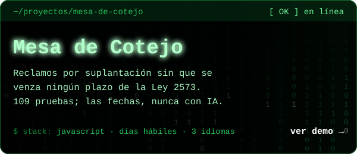
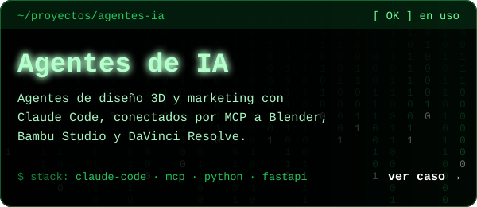
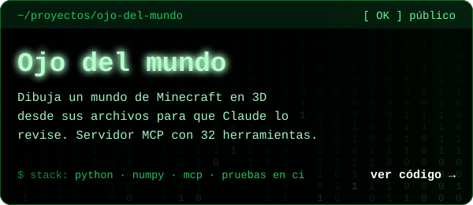
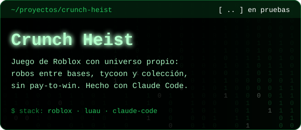

<div align="center">

<a href="https://dsergio909.github.io/"></a>

<a href="https://dsergio909.github.io/"></a>
<a href="https://linkedin.com/in/sergio-david-garcia-celis-836b8a250"></a>
<a href="mailto:dsergio909@gmail.com"></a>

<sub>Español · <a href="#english">English below ↓</a></sub>

</div>


## `> whoami`

Profesional en **Negocios Internacionales** (Universidad Santo Tomás, grado en trámite) en Bogotá, Colombia. Resuelvo problemas operativos con la herramienta que el problema pida: **automatización, IA generativa, código y datos**. No vengo de ingeniería: aprendo construyendo.

Trabajo como director de un equipo de IAs: unas diseñan, otras hacen el volumen y Claude audita todo antes de que llegue a producción. Lo dudoso siempre pasa por una persona, y nada sale sin pruebas.

Busco un rol **remoto o híbrido (Bogotá)** en automatización de procesos, operaciones con IA o mercadeo digital.


## `> ls ./proyectos`

<a href="https://dsergio909.github.io/supplier-radar/"></a>
<a href="https://dsergio909.github.io/supplier-scout/"></a>
<a href="https://dsergio909.github.io/mesa-de-cotejo/"></a>
<a href="https://dsergio909.github.io/#caso-foxy"></a>
<a href="https://github.com/Dsergio909/ojo-del-mundo"></a>


<sub>Código: [supplier-radar](https://github.com/Dsergio909/supplier-radar) · [supplier-scout](https://github.com/Dsergio909/supplier-scout) · [mesa-de-cotejo](https://github.com/Dsergio909/mesa-de-cotejo) · [ojo-del-mundo](https://github.com/Dsergio909/ojo-del-mundo) · el de los agentes es privado.</sub>


## `> tail logros.log`

Cifras reales de mi registro de trabajo. Cada entrega lleva su verificación.

```text
[ OK ] supplier-scout     58 de 58 proveedores comprobados por NIT · 199 pruebas
[ OK ] supplier-radar     159/201 fotos difíciles bien leídas · 0 aplicadas mal
[ OK ] mesa-de-cotejo     109 pruebas · 24 de 24 fallas de auditoría corregidas
[ OK ] ojo-del-mundo      32 herramientas MCP · pruebas en Windows y Linux
[ OK ] expedientes        64.250 páginas unificadas para una entidad pública
                          212 de 212 archivos verificados uno por uno
[ OK ] software TRD       170 pruebas automáticas · 129 de 129 códigos
                          iguales a los del archivista
[ OK ] panel de mercadeo  46 pruebas · leyó 285 videos de 14 cuentas con IA local
[ OK ] video con IA       generado en mi propio PC, sin nube, con 8 GB de VRAM
```


## `> cat stack.txt`

```text
ia_y_agentes     Claude Code · MCP · Gemini · IA local (Ollama)
automatizacion   Apps Script · AppSheet · n8n · Make
3d_y_video       Blender · DaVinci Resolve · Bambu Studio · Inkscape · Canva
negocios_datos   Excel · Bloomberg Market Concepts
aprendiendo      Power BI · SQL
explorando       Antigravity · Google Flow · Higgsfield · Adobe
```


<a name="english"></a>
<details>
<summary><h2>🌎 English</h2></summary>

### `> whoami`

**International Business** graduate (Universidad Santo Tomás, diploma pending) based in Bogotá, Colombia. I solve operational problems with whatever tool the problem calls for: **automation, generative AI, code and data**. I don't come from an engineering background: I learn by building.

I work as the director of a team of AIs: some design, others handle the volume, and Claude audits everything before it ships. Anything unclear always goes to a person, and nothing ships without tests.

Looking for a **remote or hybrid (Bogotá)** role in process automation, AI operations or digital marketing.

### `> ls ./projects`

| Project | What it is | Links |
|---|---|---|
| **Supplier Radar** | Public rebuild, with synthetic data, of the supplier and contract system I built during my procurement internship: automatic document requests, confidence-tiered reply detection (unclear cases go to human review), documents read by content, even phone photos, and checked for age, and dashboards computed from dates only. Apps Script, zero paid tools. | [Demo](https://dsergio909.github.io/supplier-radar/) · [Code](https://github.com/Dsergio909/supplier-radar) |
| **Supplier Scout** | Finds suppliers the way purchasing does: national companies and individuals that already sell to the state (SECOP II), your own suppliers, nearby businesses and ready-made web searches, then a shortlist and quote requests. 58 of 58 national suppliers verified by tax ID. | [Demo](https://dsergio909.github.io/supplier-scout/) · [Code](https://github.com/Dsergio909/supplier-scout) |
| **Mesa de Cotejo** | Operations desk for a lender to handle identity-theft claims without missing any deadline of Colombia's Law 2573 of 2026: legal clock in business days, evidence score, fraud networks and two-signature approvals. Legal dates come from code, never from AI. 109 tests. | [Demo](https://dsergio909.github.io/mesa-de-cotejo/) · [Code](https://github.com/Dsergio909/mesa-de-cotejo) |
| **AI agents** | 3D design and marketing agents built with Claude Code, connected to Blender, Bambu Studio and DaVinci Resolve, plus a local inventory and content dashboard (Python, FastAPI, SQLite). | [Case study](https://dsergio909.github.io/?lang=en#caso-foxy) (private code) |
| **Ojo del mundo** | Draws a Minecraft world in 3D straight from its save files so Claude can review it without screenshots. MCP server with 32 tools; tests run on Windows and Linux. | [Code](https://github.com/Dsergio909/ojo-del-mundo) |
| **Crunch Heist** | Roblox game with an original world: base raids, tycoon and collection, no pay-to-win. Built with Claude Code. | In testing |

### `> tail achievements.log`
```text
[ OK ] supplier-scout     58 of 58 suppliers verified by tax ID · 199 tests
[ OK ] supplier-radar     159/201 hard photos read right · 0 wrongly applied
[ OK ] mesa-de-cotejo     109 tests · 24 of 24 audit findings fixed
[ OK ] ojo-del-mundo      32 MCP tools · tests on Windows and Linux
[ OK ] case files         64,250 pages consolidated for a public agency
                          212 of 212 files verified one by one
[ OK ] TRD software       170 automated tests · 129 of 129 codes
                          matching the archivist's
[ OK ] marketing panel    46 tests · read 285 videos from 14 accounts with local AI
[ OK ] AI video           generated on my own PC, no cloud, with 8 GB of VRAM
```

### `> cat stack.txt`
Claude Code · MCP · Gemini · Local LLMs (Ollama) · Apps Script · AppSheet · n8n · Make · Blender · DaVinci Resolve · Bambu Studio · Inkscape · Canva · Excel · Bloomberg Market Concepts. Learning now: Power BI · SQL.

### `> contact`
[Portfolio](https://dsergio909.github.io/) · [LinkedIn](https://linkedin.com/in/sergio-david-garcia-celis-836b8a250) · [dsergio909@gmail.com](mailto:dsergio909@gmail.com)

</details>

<div align="center"><sub>El banner se actualiza solo cada día con mi último proyecto público.</sub></div>
